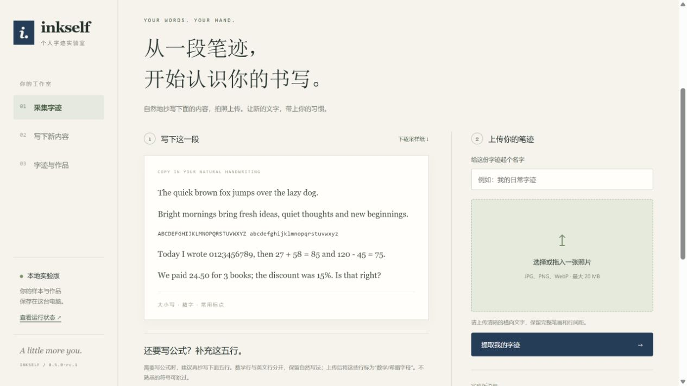

<p align="center">
  
</p>

<h1 align="center">Inkself</h1>

<p align="center"><strong>New words. Familiar handwriting.</strong></p>
<p align="center">A personal handwriting app for Windows and macOS. Give new content your own writing style.<br>Local AI · Markdown import · Adjustable spacing · Handwritten PDFs</p>

<p align="center">
  <a href="https://github.com/Ruoyu-Tianyi/inkself/releases/tag/v0.5.0-rc.1"></a>
  <a href="https://github.com/Ruoyu-Tianyi/inkself/actions/workflows/tests.yml"></a>
  <a href="LICENSE"></a>
</p>

<p align="center"><a href="README.md">简体中文</a> · <strong>English</strong></p>
<p align="center"><a href="#download">Download</a> · <a href="#start">Try it</a> · <a href="#features">Features</a> · <a href="#docs">Documentation</a> · <a href="https://github.com/Ruoyu-Tianyi/inkself/issues">Report an issue</a></p>

> **Desktop preview · 0.5.0-rc.1**<br>
> Installation, sample capture, generation, and PDF export are available. Handwriting similarity and content accuracy still need human review. Automatic high-fidelity cloning from any short sample remains a research goal.



<p align="center"><sub>Actual app interface with an empty data directory. Only printed sample prompts are shown; no personal handwriting or private documents are included.</sub></p>

<a id="download"></a>

## Download the app

| Your device | Installer | Installation |
| --- | --- | --- |
| Windows 10 / 11 · x64 | [Download Windows installer](https://github.com/Ruoyu-Tianyi/inkself/releases/download/v0.5.0-rc.1/Inkself-Windows-x64-Setup.exe) | Run the installer, then open Inkself |
| Mac · Apple Silicon | [Download macOS arm64](https://github.com/Ruoyu-Tianyi/inkself/releases/download/v0.5.0-rc.1/Inkself-macOS-arm64.dmg) | Open the DMG and drag the app to Applications |
| Mac · Intel | [Download macOS x86_64](https://github.com/Ruoyu-Tianyi/inkself/releases/download/v0.5.0-rc.1/Inkself-macOS-x86_64.dmg) | Open the DMG and drag the app to Applications |

Installers include the CPU AI runtime. **No Python setup, API key, or dedicated GPU is required.** Initial setup downloads approximately **580 MB** of model files separately. Once verified, they can be used to generate handwriting offline.

The Windows package is unsigned; Mac packages are ad-hoc signed and not yet notarized. Your operating system may block them. For installation and troubleshooting, see the [Windows guide](docs/desktop-guide.md) / [Mac guide](docs/macos-guide.md). [Release and checksums](https://github.com/Ruoyu-Tianyi/inkself/releases/tag/v0.5.0-rc.1) · [What's new](docs/release-0.5.0.md) · [All releases](https://github.com/Ruoyu-Tianyi/inkself/releases)

<a id="start"></a>

## Start with your first sample

1. **Prepare local AI.** Open the app, click **准备本地 AI** (Prepare local AI), and wait for the initial download and verification to finish.
2. **Write a sample and take a photo.** Copy the app's English and digit prompts in your usual handwriting. Upload a PNG, JPEG, or WebP image, then review and confirm the text lines.
3. **Try new content.** Enter text or import an `.md` document, choose a spacing style, and click **生成试写** (Generate sample). Start with a short paragraph and compare it with your original handwriting.
4. **Review and export.** Check letters, digits, and symbols before exporting a PDF. Your handwriting profiles and local draft remain available the next time you open the app.

**Choose a path based on the samples you have:**

| | Generate directly from an uploaded photo | Use a prepared personal glyph profile |
| --- | --- | --- |
| What you need | A photo of English and digits, with segmented text lines confirmed | A manually annotated, character-by-character reviewed glyph bank; habit adaptation also requires fitting |
| What you can do | Generate new words, sentences, digits, and some punctuation with a few-shot model | Get finer glyph control, longer documents, assignment layouts, and structured formulas |
| Input limit per generation | 3,000 characters | Habit adaptation / glyph fidelity: 20,000 characters |
| Current setup effort | Can be completed in the app by ordinary users | Glyph banks still need developer preparation; uploading an image does not create one automatically |

The optional math sample area stores your personal symbol samples. **Copying and uploading mathematical symbols does not mean the app has automatically learned how you write them.** See the [AI workflow](docs/ai-workflow.md) for details.

<a id="features"></a>

## From short sentences to full documents

| Feature | What you can do |
| --- | --- |
| **Personal handwriting profiles** | Save multiple samples, style caches, and preferences for future content. Generation, previews, and document history are processed locally. |
| **One-click spacing styles** | Choose Natural, Neat, Compact, or Relaxed, then fine-tune letter, word, line, paragraph, digit, and symbol spacing, as well as baseline movement and variation. |
| **Markdown → handwriting** | Extract visible text from headings, paragraphs, lists, and emphasis, then review conversion notices before generating. Formulas require a prepared glyph profile; the source text is saved with the result. |
| **Long documents and assignments** | Automatically wrap and paginate text, handling question numbers, multiple-choice columns, tables, and text decision trees. Keep each question together where possible and reduce isolated lines. Requires a prepared glyph profile. |
| **Mathematical content** | Write subscripts, superscripts, fractions, roots, nested brackets, Greek letters, sums, and integrals. Requires a prepared glyph profile; you can explicitly enable companion glyphs for missing supported math symbols. |
| **Keep editing, export anytime** | Local drafts save automatically, and edits made during generation are preserved. Includes A4 previews, PDF export, document history, and comparison with the original image. |

Word, line, and paragraph spacing and word baseline movement work in every mode. **Spacing within words, numbers, and symbol sequences** requires habit adaptation or glyph fidelity mode; unavailable controls are disabled. These preferences are reproducible layout settings, not evidence that the app has learned those habits from your samples. See the [spacing guide](docs/spacing-controls.md).

<a id="faq"></a>

## Before you begin

<details>
<summary><strong>Can a short sample produce handwriting exactly like mine?</strong></summary>

Not reliably yet. The current few-shot model can generate words absent from your samples, but similarity across writers, natural joins, and text accuracy are still being evaluated. Habit adaptation and glyph fidelity can improve results using reviewed glyphs from your handwriting, but still require manual preparation. They do not generate continuous strokes across an entire paragraph or automatically learn every character from any unannotated short sample.

</details>

<details>
<summary><strong>Does it support Chinese and complex formulas?</strong></summary>

English and digits are the main focus; Chinese handwriting generation is not supported yet. The default neural model supports only some punctuation in its alphabet, not equals signs, dollar signs, or structured formulas. Structured formulas require habit adaptation or glyph fidelity mode, `$...$` / `$$...$$` input, and the corresponding glyphs. Only a subset of LaTeX syntax is supported, not full LaTeX documents or environments such as matrices. Companion math glyphs must be explicitly enabled; their shapes are not learned from your samples. See the [math and documents guide](docs/math-and-documents.md).

</details>

<details>
<summary><strong>Do I need an external AI service? Are my samples uploaded?</strong></summary>

No API key or cloud AI service is required. Installers include a local CPU inference runtime. You initiate the download of a pinned model version during setup, then use it offline. Samples, transcriptions, style caches, and documents are stored locally by default and are not uploaded with the model download. Use only your own samples or samples you have permission to use. The app does not provide signature or identity verification. See the [third-party model notice](docs/model-notice.md) for model sources and licensing.

</details>

<details>
<summary><strong>Can I use the output immediately? Are PDFs searchable?</strong></summary>

Review the result first. Independent OCR and automatic correction are not integrated, so successful generation does not guarantee that every letter, digit, or symbol is correct. PDFs contain handwriting images without a searchable text layer.

</details>

<a id="docs"></a>

## Find the right guide

| What you want to do | Start here |
| --- | --- |
| Install, set up, or troubleshoot | [Windows desktop guide](docs/desktop-guide.md) · [Mac installation guide](docs/macos-guide.md) |
| Adjust spacing and writing rhythm | [Spacing guide](docs/spacing-controls.md) |
| Import documents and lay out formulas or assignments | [Markdown import](docs/markdown-import.md) · [Math and documents](docs/math-and-documents.md) |
| Understand sampling, AI, and manual preparation | [AI workflow](docs/ai-workflow.md) · [Habit adaptation experiments](docs/habit-adapter.md) |
| Run reproducible comparisons | [Experiment workflow](docs/experiment-workflow.md) · [Public evaluation texts](examples/evaluation-suite.json) |
| Check releases and future plans | [0.5.0 release notes](docs/release-0.5.0.md) · [Product roadmap](docs/roadmap.md) |

## Development and contributions

Report bugs or suggest improvements through [Issues](https://github.com/Ruoyu-Tianyi/inkself/issues). Include your operating system, app version, steps to reproduce, and expected result. Remove personal handwriting, private documents, and identifying information before sharing screenshots or logs publicly. Read the [contribution policy](CONTRIBUTING.md) before submitting code.

<details>
<summary><strong>Run from source and check the code (developers)</strong></summary>

The following steps are for Windows development and require Python **3.10–3.12**. Ordinary users can use the installers above.

```powershell
git clone https://github.com/Ruoyu-Tianyi/inkself.git
cd inkself
./setup-web.ps1
./.local/model-env/Scripts/python.exe -m pip install -r desktop-requirements.txt
./.local/model-env/Scripts/python.exe desktop.py
```

Run checks in the project's Python environment. UI checks also require Node.js:

```powershell
./.local/model-env/Scripts/python.exe -m unittest discover -s tests -v
node --check web/static/app.js
node --test tests/test_spacing_ui.cjs tests/test_workflow_ui.cjs
```

`web/` contains the app interface, local API, and inference adapter. `ai_worker.py`, `packaging/`, and build scripts handle desktop distribution. `engines/glyphs/` provides auxiliary glyph tools and comparison utilities. Model weights, private samples, and local reports are not committed to the repository.

See the [development environment guide](docs/web-guide.md) for setup and local UI debugging, and the [architecture](docs/architecture.md) for implementation details.

</details>

**Validation progress:** For `0.5.0-rc.1`, 277 of 278 local Python checks passed; 1 was skipped because of Windows symlink permissions. All 17 UI state tests passed. Windows and Mac build, native window, and PDF export records are on the [release page](https://github.com/Ruoyu-Tianyi/inkself/releases/tag/v0.5.0-rc.1); continuous integration is on [Actions](https://github.com/Ruoyu-Tianyi/inkself/actions/workflows/tests.yml). These checks validate software behavior. **Personal likeness and generalization across writers still require human evaluation.**

## License and acknowledgments

Inkself's own code is licensed under [PolyForm Noncommercial 1.0.0](LICENSE). It is a **source-available project with use restrictions**. Noncommercial use and institutional uses expressly listed in the license are permitted under its terms. Commercial use outside that scope requires separate written authorization; the author retains commercial licensing rights. See the [commercial licensing notice](COMMERCIAL-LICENSE.md). Third-party components, fonts, and models retain their own licenses.

Image-based style generation uses [VATr++](https://huggingface.co/blowing-up-groundhogs/vatrpp); see the [model notice](docs/model-notice.md) for its source, pinned version, and adaptation details. Thanks to [TypeScribe](https://github.com/rudyoactiv/typescribe-handwriting) for inspiring the early experiments. The current app does not use TypeScribe's handwriting trajectory priming interface.
