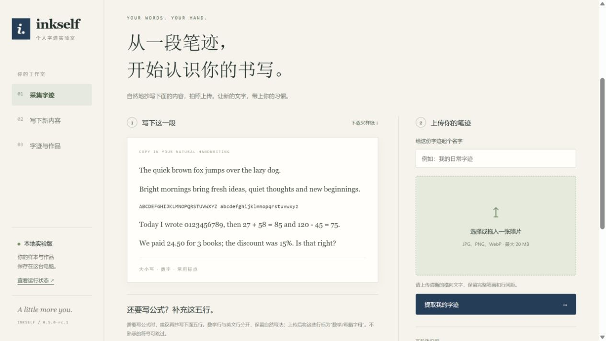

<p align="center">
  
</p>

<h1 align="center">Inkself</h1>

<p align="center"><strong>新的内容，熟悉的笔迹。</strong></p>
<p align="center">面向 Windows 和 macOS 的个人字迹应用，让新内容带上你的书写风格。<br>本地 AI · Markdown 导入 · 间距调节 · 手写 PDF</p>

<p align="center">
  <a href="https://github.com/Ruoyu-Tianyi/inkself/releases/tag/v0.5.0-rc.1"></a>
  <a href="https://github.com/Ruoyu-Tianyi/inkself/actions/workflows/tests.yml"></a>
  <a href="LICENSE"></a>
</p>

<p align="center"><strong>简体中文</strong> · <a href="README.en.md">English</a></p>
<p align="center"><a href="#download">下载应用</a> · <a href="#start">开始试写</a> · <a href="#features">功能</a> · <a href="#docs">使用文档</a> · <a href="https://github.com/Ruoyu-Tianyi/inkself/issues">反馈问题</a></p>

> **桌面预览版 · 0.5.0-rc.1**<br>
> 已提供安装、采样、生成与 PDF 导出流程；字迹相似度和内容准确性仍需人工核对。“任意短样本自动高保真克隆”仍是研发目标。



<p align="center"><sub>实际应用界面，使用空白数据目录；画面仅含印刷采样提示，不含个人字迹或私人文档。</sub></p>

<a id="download"></a>

## 下载应用

| 你的设备 | 安装包 | 安装方式 |
| --- | --- | --- |
| Windows 10 / 11 · x64 | [下载 Windows 安装器](https://github.com/Ruoyu-Tianyi/inkself/releases/download/v0.5.0-rc.1/Inkself-Windows-x64-Setup.exe) | 运行安装器，安装后打开 Inkself |
| Mac · Apple Silicon | [下载 macOS arm64](https://github.com/Ruoyu-Tianyi/inkself/releases/download/v0.5.0-rc.1/Inkself-macOS-arm64.dmg) | 打开 DMG，将应用拖入 Applications |
| Mac · Intel | [下载 macOS x86_64](https://github.com/Ruoyu-Tianyi/inkself/releases/download/v0.5.0-rc.1/Inkself-macOS-x86_64.dmg) | 打开 DMG，将应用拖入 Applications |

安装包内置 CPU AI 引擎，**无需配置 Python、API 密钥或独立显卡**。首次设置另行下载约 **580 MB** 模型文件，校验完成后可离线生成。

当前 Windows 包未签名，Mac 包采用临时签名、尚未公证，系统可能提示拦截。安装与排错请看 [Windows 指南](docs/desktop-guide.md) / [Mac 指南](docs/macos-guide.md)。[发布页与校验值](https://github.com/Ruoyu-Tianyi/inkself/releases/tag/v0.5.0-rc.1) · [本版更新](docs/release-0.5.0.md) · [全部版本](https://github.com/Ruoyu-Tianyi/inkself/releases)

<a id="start"></a>

## 从第一份试写开始

1. **准备本地 AI。** 打开应用，点击“准备本地 AI”，等待首次下载与校验完成。
2. **写一段，拍一张。** 自然抄写应用给定的英文与数字，上传 PNG、JPEG 或 WebP 图片，检查并确认文字行。
3. **写下新内容。** 输入文字或导入 `.md` 文档，选择间距风格，点击“生成试写”。先从短段落开始对照原稿。
4. **核对并导出。** 检查字母、数字和符号，再导出 PDF；下次打开可继续使用字迹档案和本机草稿。

**按你已有的样本选择使用路径：**

| | 照片上传后直接试写 | 已准备个人字形档案 |
| --- | --- | --- |
| 准备什么 | 英文与数字照片，确认切分后的文字行 | 经人工标注、逐字核对的字形库；习惯适配还需拟合 |
| 可以做什么 | 用少样本模型生成新词句、数字及部分标点 | 更细的字形控制、长文、作业答卷和结构化公式 |
| 每次输入上限 | 3,000 字符 | 习惯适配 / 字形保真：20,000 字符 |
| 当前门槛 | 普通用户可在应用内完成 | 字形库目前仍需开发者准备，上传图片不会自动建立 |

可选数学采样区用于保存个人符号样本。**抄写并上传数学符号，不等于应用已自动学会你的数学写法。** 详细流程见 [AI 工作流程](docs/ai-workflow.md)。

<a id="features"></a>

## 从短句到完整文档

| 功能 | 你能用它做什么 |
| --- | --- |
| **个人字迹档案** | 保存多份样本、风格缓存与偏好，用于之后的新内容；生成、预览和历史作品都在本机处理。 |
| **一键调整书写节奏** | 选择自然、工整、紧凑、宽松四种风格，再微调字母、词、行、段落、数字、符号间距，以及上下起伏和变化幅度。 |
| **Markdown → 手写稿** | 提取标题、段落、列表与强调中的可见文字，检查转换提示后生成；公式需已准备字形档案，原文随作品保存。 |
| **长文与作业排版** | 自动换行分页，处理题号、选择题分栏、表格和文本决策树，尽量保留同题内容并减少孤行。需要已准备字形档案。 |
| **数学内容** | 支持上下标、分式、根号、多级括号、希腊字母、求和与积分。需要已准备字形档案；缺少的受支持数学符号可明确选择配套字形。 |
| **继续编辑，随时导出** | 本机草稿自动保存，生成期间的新修改受到保护；支持 A4 预览、PDF 导出、历史作品和原图对照。 |

词间距、行距、段落间距与词语上下起伏适用于全部模式。**词内字母、数字和符号间距**需要习惯适配或字形保真模式；不适用时控件会禁用。间距偏好是可复现的排版设置，并不表示已从样本中学得这些习惯。详见 [间距调节指南](docs/spacing-controls.md)。

<a id="faq"></a>

## 先了解这些

<details>
<summary><strong>一小段样本，就能生成和本人完全一样的字迹吗？</strong></summary>

还不能保证。当前少样本模型可以生成样本之外的新词，但不同人的相似度、连笔自然度与文字准确性仍在验证。习惯适配和字形保真可利用经核对的原稿字形改善效果，仍需人工准备；它们不是完整段落级的连续笔画生成，也不能从任意未标注短样本自动学会所有字符。

</details>

<details>
<summary><strong>支持中文和复杂公式吗？</strong></summary>

当前主要支持英文与数字，尚不支持中文手写生成。默认神经模型仅支持字母表内的部分标点，不支持等号、美元符号和结构化公式。结构化公式需在习惯适配或字形保真模式中，用 `$...$` / `$$...$$` 输入，并具备对应字形；支持部分 LaTeX 语法，不支持完整 LaTeX 文档或矩阵等环境。配套数学字形须明确启用，其形状并非从你的样本学得。详见 [数学与文档指南](docs/math-and-documents.md)。

</details>

<details>
<summary><strong>还需要外部 AI 服务吗？样本会上传吗？</strong></summary>

不需要 API 密钥或云端 AI 服务。安装包自带本地 CPU 推理引擎，首次由你操作下载固定版本的模型资产，之后可离线使用。样本、转录、风格缓存和文档默认保存在本机，不会随模型下载上传。只使用本人或经授权的样本；应用不提供签名或身份认证功能。模型来源与许可见 [第三方模型说明](docs/model-notice.md)。

</details>

<details>
<summary><strong>生成的内容可以直接交付吗？PDF 能搜索文字吗？</strong></summary>

请先人工核对。当前未接入独立 OCR 与自动纠错，生成成功不代表字母、数字或符号全部正确。PDF 保存的是手写图像，没有可搜索的文字层。

</details>

<a id="docs"></a>

## 找到你需要的文档

| 想做什么 | 从这里开始 |
| --- | --- |
| 安装、首次设置与排错 | [Windows 桌面指南](docs/desktop-guide.md) · [Mac 安装指南](docs/macos-guide.md) |
| 调整字距和书写节奏 | [间距调节指南](docs/spacing-controls.md) |
| 导入文档、排版公式与答卷 | [Markdown 导入](docs/markdown-import.md) · [数学与文档](docs/math-and-documents.md) |
| 理解采样、AI 与人工准备步骤 | [AI 工作流程](docs/ai-workflow.md) · [习惯适配实验](docs/habit-adapter.md) |
| 做可重复的对比测试 | [实验与复现流程](docs/experiment-workflow.md) · [公共测试文本](examples/evaluation-suite.json) |
| 查看版本与后续方向 | [0.5.0 更新说明](docs/release-0.5.0.md) · [产品路线](docs/roadmap.md) |

## 开发与参与

欢迎通过 [Issues](https://github.com/Ruoyu-Tianyi/inkself/issues) 反馈问题或建议。请附系统、应用版本、复现步骤与预期结果；公开截图和日志前，移除个人字迹、私人文档及身份信息。提交代码前请阅读 [贡献政策](CONTRIBUTING.md)。

<details>
<summary><strong>从源码运行与检查（开发者）</strong></summary>

以下为 Windows 开发环境步骤，需要 Python **3.10–3.12**。普通用户使用上面的安装包即可。

```powershell
git clone https://github.com/Ruoyu-Tianyi/inkself.git
cd inkself
./setup-web.ps1
./.local/model-env/Scripts/python.exe -m pip install -r desktop-requirements.txt
./.local/model-env/Scripts/python.exe desktop.py
```

检查代码；界面检查另需 Node.js：

```powershell
./.local/model-env/Scripts/python.exe -m unittest discover -s tests -v
node --check web/static/app.js
node --test tests/test_spacing_ui.cjs tests/test_workflow_ui.cjs
```

`web/` 包含应用界面、本地 API 与推理适配器；`ai_worker.py`、`packaging/` 和构建脚本负责桌面分发；`engines/glyphs/` 提供辅助字形与对照工具。模型权重、私人样本与本机报告不提交到仓库。

环境安装与本地界面调试见 [开发环境指南](docs/web-guide.md)，实现结构见 [技术结构](docs/architecture.md)。

</details>

**验证进展：** `0.5.0-rc.1` 本地 278 项 Python 检查中 277 项通过，1 项因 Windows 符号链接权限跳过；另有 17 项界面状态测试通过。Windows 与 Mac 构建、原生窗口及 PDF 导出记录见 [版本发布页](https://github.com/Ruoyu-Tianyi/inkself/releases/tag/v0.5.0-rc.1)，持续集成见 [Actions](https://github.com/Ruoyu-Tianyi/inkself/actions/workflows/tests.yml)。这些检查验证软件行为；**本人相似度与跨用户泛化仍在真人验收中**。

## 许可与致谢

Inkself 自有代码采用 [PolyForm Noncommercial 1.0.0](LICENSE)，是**限制用途的源码可用项目**。非商业用途及许可明确列出的机构用途可按条款使用；超出许可范围的商业使用须取得单独书面授权，作者保留商业化授权权利。详见 [商业授权说明](COMMERCIAL-LICENSE.md)。第三方组件、字体与模型保留各自许可。

静态图片风格生成基于 [VATr++](https://huggingface.co/blowing-up-groundhogs/vatrpp)，来源、固定版本与适配说明见 [模型说明](docs/model-notice.md)。感谢 [TypeScribe](https://github.com/rudyoactiv/typescribe-handwriting) 对早期实验的启发；当前应用并非 TypeScribe 的笔迹轨迹 priming 接口。
